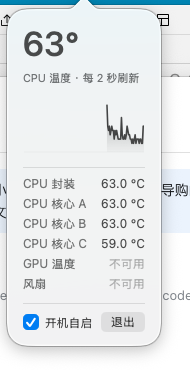

# 风扇管家 FanMenuBar

macOS 菜单栏 CPU 温度监控小工具，为这台黑苹果笔记本（MacBookPro16,1 / i7-8750H / OpenCore）定制。
形态和已有的 IPMenuBar 一致：常驻菜单栏、点开看详情、登录自动启动。



> 开发环境：OpenCore 黑苹果（MacBookPro16,1 机型伪装 / i7-8750H / Clevo GK5CN5X 准系统）。
> 温度数据走 AppleSMC 用户态只读接口，Intel Mac 与黑苹果通用，无需 root、无第三方依赖。
> 风扇转速与控制在本机不可用，原因见[下文](#为什么没有风扇转速--控制)。

## 功能

- 菜单栏常驻 `🌡 63°`，≥70°C 变橙、≥85°C 变红，不占 Dock；
- 点开面板：CPU 封装/核心 A/B/C 四路温度 + 近 5 分钟曲线；
- GPU 温度、风扇转速：本机 SMC 不提供，面板如实显示"不可用"（详见下文）；
- 开机自启（LaunchAgent），面板内可一键开关；
- 纯只读，不写任何硬件寄存器，退出无副作用。

## 构建 / 安装

依赖：macOS 12+、Xcode 命令行工具（`xcode-select --install`）。无 root、无签名证书、无第三方依赖。

```bash
git clone https://github.com/Blazer-YJJ/FanMenuBar.git
cd FanMenuBar
./build.sh
cp -R build/FanMenuBar.app /Applications/
open /Applications/FanMenuBar.app
```

覆盖安装前先退出旧进程：

```bash
pkill -f FanMenuBar.app
rm -rf /Applications/FanMenuBar.app && cp -R build/FanMenuBar.app /Applications/
open /Applications/FanMenuBar.app
```

因为只有 ad-hoc 签名（未公证），首次启动若被 Gatekeeper 拦下，用 `open` 命令启动，或在
「系统设置 → 隐私与安全性」里点「仍要打开」。

## 开机自启

- 首次启动会自动写入 `~/Library/LaunchAgents/local.tools.fanmenubar.plist`；
- 下次登录由 launchd 自动拉起，面板里的"开机自启"复选框可随时关掉（会删除该 plist 并 bootout）；
- 只保留单实例：若 launchd 与手动启动撞车，后启动的会自己退出。

验证：

```bash
launchctl print gui/$(id -u)/local.tools.fanmenubar | head -5
```

## 卸载

```bash
pkill -f FanMenuBar.app
launchctl bootout gui/$(id -u)/local.tools.fanmenubar 2>/dev/null
rm -f ~/Library/LaunchAgents/local.tools.fanmenubar.plist
rm -rf /Applications/FanMenuBar.app
```

## 为什么没有风扇转速 / 控制

实测（2026-11-24，探针见 PRD 附录）：

| 项 | 结果 |
|---|---|
| `TC0P` 等 CPU 温度 | ✅ `sp78` 正常，空闲 60–70°C，满载 77°C |
| `FNum` | ❌ 返回 0，系统认为没有 SMC 风扇 |
| `F0Ac` `F0Mn` `F0Mx` `F0Tg` | ❌ `0x84 key not found` |
| `TG0P` 等 GPU 温度 | ❌ key not found（dGPU 被 `-wegnoegpu` 禁用，核显无 SMC 温度键） |

这台 Clevo/Hasee 准系统的风扇归 EC（嵌入式控制器）管，VirtualSMC 的 `SMCSuperIO` 没识别到它的芯片，
所以不会生成任何 `F*` 风扇键。要做风扇控制只能写 Lilu 插件直接读写 EC 寄存器（路线 B），
需要改 EFI、多次重启调试，且有死机风险——当前选择先交付只读版（路线 A）。

## 代码结构

```
src/main.m       菜单栏、弹窗面板、曲线、开机自启、单实例
src/SMCReader.m  AppleSMC 用户态只读（SMCKeyData_t + IOConnectCallStructMethod）
build.sh         编译 + 打包 .app + ad-hoc 签名
PRD.md           需求与阶段 0 实测记录
```

### 踩过的坑（重要）

SMC 的 key 是 **4 字节 ASCII**，不是十六进制数：

```c
key = ('T' << 24) | ('C' << 16) | ('0' << 8) | 'P';   // ✅ 0x54433050
key = 0x54433050 写成了 0x70724330 之类 → result 0x84 key not found
```

调试开关：`FANMENUBAR_SNAPSHOT=1 open -a FanMenuBar` 会把面板渲染到 `/tmp/fanmenubar-panel.png`。
